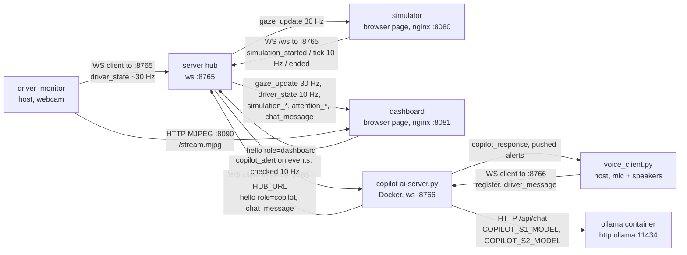

# Architecture

The system watches a driver with a webcam while they drive in a browser simulator, and warns them by screen and
by voice. Everything meets in one central WebSocket hub, `server_simulator_lookingdir/server.py` on port 8765.
The **driver monitor** (webcam) and the **simulator** (objects around the car) send their data to it. The hub
works out where the driver is looking, whether they looked at each car / bike / person in time, and whether
their eyes are closed or their attention is elsewhere. It sends the gaze to the simulator, the cleaned state to
the **dashboard**, and short "say this now" alerts to the **AI copilot**. The copilot speaks through the
**voice client** (microphone and speakers on the host) and answers the driver's spoken questions with local
Ollama models. The driver monitor reports only three detections: `EYES_CLOSED`, `DISTRACTED` and `PHONE_USE`.
Tiredness detection (drowsiness, yawns, nods and so on) was removed from the whole project on purpose, because it
gave too many false positives.



## Ports and endpoints

| Service | Runs where | Listens on | Connects to |
|---|---|---|---|
| `server` (hub, `server_simulator_lookingdir/`) | Docker (`compose.yml` service `server`) or host | `ws://0.0.0.0:8765` in Docker, host port `SERVER_PORT` (8765); `HOST`/`PORT` env, default `localhost:8765` outside Docker | nothing (pure server) |
| `simulator` (`simulator/`) | Docker (nginx), page runs in the browser | `http://localhost:8080` (`SIMULATOR_PORT`), container port 80 | `ws://<page host>/ws`, nginx proxies to `http://server:8765`; opened as a file: `ws://localhost:8765` |
| `dashboard` (`dashboard/`) | Docker (nginx), page runs in the browser; dev: `npm run dev` | `http://localhost:8081` (`DASHBOARD_PORT`), container port 80; dev server `:5173` | `ws://<page host>/ws` (build arg `VITE_WS_URL=/ws`, proxied to `server:8765`); dev default `ws://localhost:8765`; camera `http://localhost:8090/stream.mjpg` (`VITE_CAMERA_URL`) |
| `driver_monitor` | Host (webcam); Docker only in the `replay` profile with a video | MJPEG `http://localhost:8090/stream.mjpg` and `/frame.jpg` (`camera_stream` in config; Docker: `0.0.0.0:8090`, published as 8090) | `ws://localhost:8765` (`websocket.url` in `config/driver_monitor.yaml`, `--ws URL`); Docker: `ws://server:8765` (`config/driver_monitor.docker.yaml`) |
| `copilot` (`copilot/ai-server.py`) | Docker (`compose.yml` service `copilot`) or host | `ws://0.0.0.0:8766` in Docker, host port `COPILOT_PORT` (8766); outside Docker `COPILOT_HOST` / `COPILOT_PORT`, default `localhost:8766` | Ollama `OLLAMA_BASE` (Docker: `http://ollama:11434`; host default `http://127.0.0.1:11434`); hub `HUB_URL` (Docker: `ws://server:8765`; host default `ws://localhost:8765`; `--hub`, `--no-hub`); `tools.py`: Google News RSS, Open-Meteo, optional `DEGOOG_URL` (Docker default `http://host.docker.internal:4444/api/search`) |
| `voice_client.py` | Host (mic, speakers); `start.bat` runs it from `copilot/.venv` | nothing | `ws://localhost:8766` (`--ws`); waits and tries again every 2 s while the copilot is not up |
| `event_simulator.py`, `test_client.py` | Host (test tools) | nothing | `ws://localhost:8766` |
| `ollama` | Docker (`compose.yml` service `ollama`, image `OLLAMA_IMAGE`, default `ollama/ollama:0.40.6`); NVIDIA GPU with `compose.gpu.yml`, else CPU (much slower) | `http://ollama:11434`, inside the compose network only (not published) | nothing; the models are kept in the `ollama` volume |
| `ollama-pull` | Docker, one-shot, once `ollama` is healthy | nothing | `ollama:11434`: pulls `COPILOT_S1_MODEL` / `COPILOT_S2_MODEL` if missing; always exits 0 |

All browser pages reach the hub through their own nginx (`/ws`). Host processes reach it through the published
port `localhost:8765`. Inside the compose network the hub is always `server:8765` and Ollama is `ollama:11434`.

## How the hub tells its clients apart

Every client uses the same port. `server.py` `route()` looks at each message, and the **first** recognised message
fixes the client's role for the whole connection:

| First message | Role | Gets from the hub |
|---|---|---|
| `{"type": "driver_state", ...}` | `camera` | nothing |
| any message with an `event` field (`simulation_*`) | `simulator` | `gaze_update` |
| `{"type": "hello", "role": "dashboard"}` | `dashboard` | `gaze_update`, cleaned `driver_state`, `simulation_started`/`_ended`, `attention_event`/`_summary`, `chat_message` |
| `{"type": "hello", "role": "copilot"}` | `copilot` | `copilot_alert` |
| `{"type": "chat_message", ...}` (no hello first) | `chat` | nothing |
| nothing yet | unknown | `gaze_update` (the simulator sends nothing before GO, so it gets gaze before it is recognised) |

Malformed messages are logged as a warning and ignored; the connection stays open. The hub keeps no history.

Hub loops (`server.py`): `send_gaze_loop` (`GAZE_HZ` = 30), `send_dashboard_loop` (`DASHBOARD_HZ` = 10),
`attention_loop` (20 Hz, look deadlines), `copilot_loop` (10 Hz, `reactions.py`). Modules: `sim.py` parses
simulator messages, `camera.py` parses and cleans `driver_state`, `alerts.py` gives each detection a category and a
one-line text, `attention.py` checks whether each object was looked at in time, `reactions.py` decides what the
copilot says.

## driver_monitor -> server

* **Direction:** driver_monitor (WebSocket client) -> hub (server). The hub never answers.
* **Transport:** `ws://localhost:8765` (`websocket.url`). Sending runs in a background thread
  (`output/ws_sender.py`). It reconnects every `reconnect_s` (2 s). Messages are dropped while disconnected, and
  when the queue is full the oldest message goes first, because the hub wants the live state.
* **Identifies itself by:** `"type": "driver_state"` in every message.

| Message | Direction | Rate | Key fields |
|---|---|---|---|
| `driver_state` (`schema_version` 2) | DM -> hub | every processed frame, ~30/s (`max_rate_hz: 0`) | `t`, `frame`, `summary{highest_severity, active[]}`, `quality{fps, camera_fps, latency_ms, face_detected, faces_in_view, issues[]}`, `calibration{status, phase, progress, message}`, `eyes{state (OPEN / CLOSED / UNKNOWN), state_for_s, openness, source}`, `head{yaw_deg, pitch_deg, roll_deg}`, `gaze{zone, zone_for_s, yaw_deg, pitch_deg}`, `detections[]{id, type, severity, status, started_t, ended_t, duration_s, details}` |

The source of truth is the pydantic model `driver_monitor/src/driver_monitor/output/schema.py`; the reference is
`driver_monitor/docs/detection-schema.md`. There is no `attention` block. Severities are only `WARNING` and
`DANGER` (`summary.highest_severity` can also be `NONE`). A detection is an episode with a stable `id`: `STARTED`,
then `ONGOING` in every message, then `ENDED` exactly once. `gaze.zone` is one of `ROAD`, `REAR_MIRROR`,
`LEFT_MIRROR`, `RIGHT_MIRROR`, `LEFT_SIDE`, `RIGHT_SIDE`, `UP`, `DOWN` or `UNKNOWN`.

| Detection | Starts (`WARNING`) | `DANGER` | Ends | `details` |
|---|---|---|---|---|
| `EYES_CLOSED` | eyes `CLOSED` for 0.5 s (`eye_closure.closed_s`) | same episode after 1.0 s (`eye_closure.danger_s`) | eyes open for 0.2 s (`reopen_s`), or no face for 1 s (`unknown_hold_s`) | `closed_for_s` |
| `DISTRACTED` | gaze `UP` or `DOWN` (none of the road / mirror / side-window zones) for 1.0 s (`distraction.start_s`) | after 2.5 s (`distraction.danger_s`) | back in one of those zones for 0.5 s (`distraction.end_s`) | `zone` (`UP` / `DOWN`), `away_s` |
| `PHONE_USE` | EfficientDet-Lite0 sees a COCO "cell phone" (score >= 0.35, ~6 checks/s) for 0.4 s (`phone.start_s`) | after 3 s (`phone.danger_s`) | no phone seen for 1 s (`phone.end_s`) | `score`, `max_score`, `box`, `seen_for_s` |

```json
{"type": "driver_state", "schema_version": 2, "t": 2.8, "frame": 85,
 "summary": {"highest_severity": "WARNING", "active": ["DISTRACTED"]},
 "quality": {"fps": 30.0, "camera_fps": null, "latency_ms": 12.0, "face_detected": true, "faces_in_view": 1, "issues": []},
 "calibration": {"status": "DEFAULTS", "phase": null, "progress": 1.0, "message": "population defaults - ..."},
 "eyes": {"state": "OPEN", "state_for_s": 2.8, "openness": 0.46, "source": "BOTH"},
 "head": {"yaw_deg": 0.0, "pitch_deg": -24.5, "roll_deg": 0.0},
 "gaze": {"zone": "DOWN", "zone_for_s": 1.7, "yaw_deg": 0.0, "pitch_deg": -46.0},
 "detections": [{"id": "distracted-1", "type": "DISTRACTED", "severity": "WARNING", "status": "ONGOING",
   "started_t": 1.1, "ended_t": null, "duration_s": 1.7, "details": {"zone": "DOWN", "away_s": 1.7}}]}
```

(This example comes from `detection-schema.md`, which generated it with `tools/scenarios.py look_down`. The
calibration message is shortened.)

What the hub does with it (`camera.py`): it stores the gaze zone, the eye state, the face and calibration state, and
the active detections. Only the three handled types are kept; anything else, and any block not in `FIELDS` /
`DASHBOARD_KEYS`, is dropped. `alerts.py` writes the display text, for example "Not paying attention - looking
down for 1.5 s" from `zone` + `away_s`. `gaze.zone` is mapped to a simulator region: `ROAD` becomes `front_left` / `front_center` /
`front_right`, split at |yaw| > `FRONT_SPLIT_DEG` (7). `LEFT_MIRROR` becomes `mirror_left`, `LEFT_SIDE` becomes
`side_left`, and so on. `UP`, `DOWN` and `UNKNOWN` become `away`. When no `driver_state` has arrived for
`CAMERA_TIMEOUT_S` (1 s), the hub treats the camera as gone.

## simulator <-> server

* **Direction:** both ways. The simulator is the client.
* **Transport:** `ws://localhost:8080/ws` (nginx proxy to `server:8765`). When `index.html` is opened as a file,
  it uses `ws://localhost:8765` directly (`js/config.js` `WS_URL`). It reconnects every 2 s.
* **Identifies itself by:** the `event` field of its messages. Nothing is sent during setup or the 3 s countdown.

| Message | Direction | Rate | Key fields |
|---|---|---|---|
| `simulation_started` | sim -> hub | once, at GO | `timestamp` (Unix s) |
| `simulation_tick` | sim -> hub | 10 Hz (`TICK_HZ`) | `timestamp`, `objects[]{object_id, type (car / truck / bicycle / motorcycle / pedestrian), x_px (+ right), y_px (+ ahead)}`: every object on the map in every tick |
| `simulation_ended` | sim -> hub | once (3 s after the last object finished, or on Esc) | `timestamp` |
| `gaze_update` | hub -> sim (and dashboards) | `GAZE_HZ` = 30 | `timestamp`, `status` (`ok` / `no_face` / `eyes_closed` / `calibrating` / `no_gaze_client`), `region` (only when `ok`), `driver` (condition block or `null`) |

```json
{"event": "simulation_tick", "timestamp": 1763640010.1,
 "objects": [{"object_id": "obj_1", "type": "car", "x_px": -110, "y_px": -364}]}
{"event": "gaze_update", "timestamp": 1763640012.345, "status": "ok", "region": "mirror_left",
 "driver": {"severity": "NONE", "eyes_closed": false, "not_paying_attention": false, "alerts": [], "recent": []}}
```

The simulator uses only `status` and `region`. It highlights the region the driver looks at and shows a badge. If no
`gaze_update` arrives for 1.5 s, it shows "No gaze data". The hub passes `simulation_started` / `simulation_ended`
to the dashboards as they are, and feeds every tick to `attention.py`.

**Attention check (`attention.py`).** Each object is placed in one of 8 zones (1 m = 31.43 px; lane edge at ±55 px).
When it enters a zone, a look window starts. The driver has to look at it, meaning the gaze region equals the zone
name for `LOOK_DWELL_S` = 0.15 s with `status ok`, before the window runs out.

| Zone | Where (`x_px`, `y_px`) | Window |
|---|---|---|
| `front_left` / `front_center` / `front_right` | x < -55 / -55..55 / > 55, 71 < y <= 943 | 0.5 s |
| `side_left` / `side_right` (blind spots) | x < -55 / > 55, -157 <= y <= 71 | 1.0 s |
| `mirror_left` / `mirror_right` | x < -55 / > 55, -943 <= y < -157 | 2.0 s |
| `mirror_center` | -55..55, -943 <= y < -71 | 2.0 s |

The result is sent as `attention_event` (`appeared`, `zone_change`, `noticed`, `missed`) to the dashboards. Each
`missed` is also queued in `reactions.py` for the copilot. `attention_summary` is sent at `simulation_ended`.

## server -> dashboard

* **Direction:** mostly hub -> dashboard. The dashboard is the client and sends only its hello.
* **Transport:** `ws://localhost:8081/ws` in Docker (nginx proxy). Dev default: `ws://localhost:8765`
  (`VITE_WS_URL`). It reconnects every 2 s (`RETRY_MS`).
* **Identifies itself by:** `{"type": "hello", "role": "dashboard"}` right after connecting (`src/useServer.ts`).

| Message | Direction | Rate | Key fields | Used by |
|---|---|---|---|---|
| `hello` | dash -> hub | once | `role: "dashboard"` | |
| `gaze_update` | hub -> dash | 30 Hz | `status`, `region`, `driver` | `narrator.ts` (CAM lines) |
| `driver_state` (cleaned, v2) | hub -> dash | <= 10 Hz, only when a new one arrived | `summary{highest_severity, active}` (recomputed from the kept detections), `quality`, `calibration`, `eyes`, `head`, `gaze`, `detections` (only the 3 types) | `hud.ts`, `narrator.ts` statistics |
| `simulation_started` / `simulation_ended` | hub -> dash | as received | `timestamp` | narrator, HUD reset |
| `attention_event` | hub -> dash | on change | `t_s`, `kind`, `object_id`, `type`, `zone`, `window_s`, `reaction_s` | narrator (SIM / OK / MISSED), HUD (`missed`) |
| `attention_summary` | hub -> dash | at the end of a run | `duration_s`, `noticed_count`, `missed_count`, `avg_reaction_s`, `missed[]` | narrator (STATS) |
| `chat_message` | hub -> dash | when a client sends one | `role` (`user` / `assistant`), `text` | `chat.ts` / `ChatPanel.tsx` |

```json
{"event": "attention_event", "timestamp": 1763640012.3, "t_s": 2.31, "kind": "missed",
 "object_id": "car_3", "type": "car", "zone": "side_left", "window_s": 1.0, "reaction_s": null}
{"type": "chat_message", "role": "assistant", "text": "Car to the left of you!"}
```

What the page shows:

* **Camera panel:** the MJPEG stream from the driver monitor (see below).
* **Simulation terminal** (`narrator.ts`): plain sentences for the run, plus a statistics table at the end.
* **Driver HUD** (`hud.ts`): one message at a time, re-evaluated every 200 ms. A message stays for at least 3 s
  (`HOLD_MS`); only a higher priority replaces it sooner.

  | Priority | Message | From |
  |---|---|---|
  | 100 | "Wake up! Open your eyes" | active `EYES_CLOSED` |
  | 90 | "Look left: A car is in your left blind spot" ... with a direction arrow | attention `missed` only; shown for 4 s (`MISSED_SHOW_MS`), removed earlier on `zone_change` / `noticed` |
  | 80 | "Put down your phone" | `PHONE_USE` |
  | 70 | "Eyes on the road: You are looking down / up" | `DISTRACTED` (`details.zone`) |
  | 40 | "The camera can't see you" | `quality.face_detected: false` for 1 s (`NO_FACE_MS`) |
  | 30 | "Look straight ahead" | calibrating |
  | 20 | "Camera not connected" / "No connection to the server" | no fresh `driver_state` / socket closed |
  | 0 | "All good" | |

  Objects that are inside their look window, or that were `noticed`, never appear on the HUD. The statistics
  table counts `DISTRACTED` episodes as "Looked up / down".
* **Chat panel** (`chat.ts`): every `chat_message`. There is no history, so lines sent while the page was closed are
  not shown.

## dashboard -> driver_monitor (MJPEG)

* **Direction:** the browser (`` in `CameraPanel.tsx`) -> driver monitor HTTP server (`output/mjpeg.py`).
* **Transport:** `GET http://localhost:8090/stream.mjpg` (`multipart/x-mixed-replace`, at most `camera_stream.fps`
  = 15 frames/s); `GET /frame.jpg` returns the latest frame once. The page reopens the stream every 2 s with
  `?a=<attempt>` while the monitor is not running.
* Frames, with the overlay drawn on them, are encoded only while at least one viewer is connected. The browser
  cannot open the webcam itself, because the driver monitor already holds it. The URL is the same in Docker,
  because the browser runs on the host. In the `replay` profile the container publishes 8090.

## server -> copilot

* **Direction:** both ways. The copilot (`ai-server.py`) is a **client** of the hub.
* **Transport:** `HUB_URL` env or `--hub URL`: `ws://server:8765` in Docker (`compose.yml`), default
  `ws://localhost:8765` on the host; `--no-hub` (or an empty `HUB_URL`) turns it off. `hub_loop()` in
  `copilot/ai-server.py` reconnects every 2 s (`HUB_RETRY_S`).
* **Identifies itself by:** `{"type": "hello", "role": "copilot"}`, sent right after connecting.

| Message | Direction | Rate | Key fields |
|---|---|---|---|
| `hello` | copilot -> hub | once | `role: "copilot"` |
| `copilot_alert` | hub -> copilot | decided 10 Hz, sent only when there is something to say | `kind`, `priority` (3 / 2 / 1), `say` (fixed text), `repeat`, `detection{id, type, severity, duration_s}` or `null`, `object{object_id, type, zone, side}` or `null` |
| `chat_message` | copilot -> hub -> dashboards | per new alert line (not for repeats), per driver question and answer | `role` (`assistant` for alerts and answers, `user` for the driver's question), `text` |

| `kind` | `priority` | When | `say` |
|---|---|---|---|
| `eyes_closed` | 3 | `EYES_CLOSED` has lasted `EYES_CLOSED_VOICE_S` (1.0 s, the moment the camera makes it `DANGER`); again every `EYES_CLOSED_REPEAT_S` (3 s) | "Open your eyes! Pay attention to the road!" |
| `missed_object` | 2 | attention `missed`, once per object and zone | "Car to the left of you!", "Person in front of you!", "Bike coming up on your right!" ... |
| `not_paying_attention` | 1 | `PHONE_USE` / `DISTRACTED` starts; again every `ATTENTION_REPEAT_S` (5 s); quiet while the eyes-closed line repeats | `PHONE_USE`: "Put the phone down! Pay attention to the road!"; `DISTRACTED` zone `DOWN`: "Stop looking down! Pay attention to the road!"; zone `UP`: "Pay attention to the road!" |

```json
{"event": "copilot_alert", "timestamp": 1763640012.3, "kind": "missed_object", "priority": 2,
 "say": "Car to the left of you!", "repeat": false, "detection": null,
 "object": {"object_id": "car_3", "type": "car", "zone": "side_left", "side": "left"}}
```

What the copilot does with it (`handle_hub_alert()`): there is no LLM call. It wraps `say` into a
`copilot_response` with `pushed: true` and the alert's numeric `priority`, and pushes it to every registered
voice client (see below). It notes the alert in the S2 session memory, so a follow-up question has context. For a
new alert (`repeat: false`) it also sends `{"type": "chat_message", "role": "assistant", "text": <say>}` back to
the hub, so the dashboard chat shows what was said; repeats are not sent, so they do not flood the chat. The
copilot's role is fixed as `copilot` by its hello, so its `chat_message`s are forwarded to the dashboards and it
never receives `gaze_update`. Without a copilot connected, the hub still logs every line as `SAY [...]`.

## copilot <-> voice_client

* **Direction:** both ways. `ai-server.py` is the **server** on `ws://localhost:8766`. Its clients are
  `voice_client.py`, `event_simulator.py` (scripted presets with `broadcast: true`) and `test_client.py`.
* **Identifies itself by:** `{"event": "register", "role": "voice_client", "session_id": "driver-main"}`. The server
  answers `{"event": "registered", "role": "voice_client", "ok": true}` and adds the connection to its push list.
  Other clients do not register; they just send requests.

| Message | Direction | When | Key fields |
|---|---|---|---|
| `register` | voice -> copilot | once after connecting | `role: "voice_client"`, `session_id` |
| request (no `event`) | voice -> copilot | after the wake word ("hey jarvis" / "jarvis", then a 15 s listening window) | `request_id`, `session_id`, `mode` (`info`; `urgent` for `!` text; `auto`), `driver_message`, `allow_tools`, `profile`, `driver`, `vehicle`; `force_command` for `/news`, `/weather` |
| `reset_session` | voice -> copilot | "reset memory" ... | `request_id`, `session_id` |
| `copilot_response` | copilot -> voice | reply to a request | `request_id`, `session_id`, `mode` (`urgent` / `info`), `priority` (`high` / `normal`), `model`, `spoken_text`, `latency_ms`, `ttft_ms`, `ttfc_ms`, `tool_used` |
| `copilot_response` with `pushed: true` | copilot -> all voice clients | a hub `copilot_alert`; or an `urgent` / `broadcast` request from another client (`event_simulator.py`) | as above plus `pushed: true`; hub alerts: `mode: "urgent"`, `alert_kind`, numeric `priority` (3 / 2 / 1), `repeat`, `object`, `detection`, `model: null`, `spoken_text` = the hub's `say` |
| `copilot_error` | copilot -> client | a request failed | `error` |

```json
{"event": "register", "role": "voice_client", "session_id": "driver-main"}
{"request_id": "vc-3", "session_id": "driver-main", "mode": "info", "allow_tools": true,
 "driver_message": "What is the weather in Cluj tomorrow?", "driver": {}, "vehicle": {}}
{"event": "copilot_response", "request_id": "vc-3", "session_id": "driver-main", "mode": "info",
 "priority": "normal", "model": "qwen3:4b-instruct", "spoken_text": "...", "latency_ms": 1180.0}
{"event": "copilot_response", "pushed": true, "mode": "urgent", "alert_kind": "missed_object", "priority": 2,
 "repeat": false, "object": {"object_id": "car_3", "type": "car", "zone": "side_left", "side": "left"},
 "detection": null, "model": null, "spoken_text": "Car to the left of you!", "latency_ms": 0.0}
```

The voice client (`copilot/voice_client.py`) runs on the host. Microphone speech-to-text is Moonshine through
`speech-recognition/stt_driving.py` (`--mic`; `--text` for keyboard input). Text-to-speech is Phonon 31M (`ptts`)
through `text-to-speech/tts_driving.py`, on the CPU. A pushed alert is spoken at once, even when the client is
idle. `priority_rank()` maps the numbers 3 / 2 / 1 and the words `high` (2) / `normal` (0) to one scale. A
higher-ranked line cuts the current speech at once, a lower-ranked one is skipped while a higher one is playing,
and any alert drops a pending conversational reply. Hub alerts do not open the 15 s listening window, because
they repeat. The driver can cut in with "stop" or "hey jarvis". When a registered voice client sends a
`driver_message`, `ai-server.py` mirrors the question (`user`) and the answer (`assistant`) to the dashboard chat
as `chat_message` through its hub connection.

## copilot -> Ollama

* **Transport:** HTTP `POST {OLLAMA_BASE}/api/chat` with streaming: `http://ollama:11434` in Docker, default
  `http://127.0.0.1:11434` on the host. Two worker pools, so an urgent request never waits behind a conversational
  one.
* **System 1** (`urgent`): `qwen3:1.7b`, `num_ctx` 512, temperature 0, `num_predict` 25: a short spoken reflex.
* **System 2** (`info`): `qwen3:4b-instruct`, `num_ctx` 4096, temperature 0.45, `num_predict` 95,
  `repeat_penalty` 1.15: the conversation, keeping 6 turns of history per `session_id`.
* `mode: "auto"` routes a request to S1 when the severity is `DANGER`, `EYES_CLOSED` or `PHONE_USE`
  is active (`URGENT_DETECTIONS`), or `surroundings.urgent_hazard` is set. A `driver_message` always goes to S2.
* Tools (`tools.py`): `/news` (degoog at `DEGOOG_URL`, falling back to Google News RSS) and `/weather`
  (Open-Meteo). A fast router picks the tool before the LLM call.
* Models can be swapped with `COPILOT_S1_MODEL` / `COPILOT_S2_MODEL` (`.env`; `ollama-pull` downloads the same
  names). Both are warmed up in the background after `ai-server.py` starts, while it already serves; a failed
  warm-up (Ollama still starting, model still downloading) is tried again every 10 s (`WARMUP_RETRY_S`).
  `--no-llm` (`COPILOT_ARGS=--no-llm` in Docker) runs without Ollama: hub alerts still work, and questions get a
  fixed answer. The hub's `copilot_alert` lines never use Ollama.

## End-to-end flows

**(a) Car in the left blind spot**

1. The simulator sends `simulation_tick` with `car_3` at `x_px` -110, `y_px` 0. `attention.py` puts it in
   `side_left` and starts a 1.0 s window. The dashboard gets `attention_event` `zone_change` ("SIM" line).
2. The driver keeps looking ahead, so `gaze_update.region` stays `front_center`. When the window runs out,
   `attention_loop` (20 Hz) emits `attention_event` `kind: "missed"`.
3. Dashboard: a "MISSED" line in the Simulation terminal, and the HUD shows "Look left: A car is in your left
   blind spot" with a left arrow for 4 s (priority 90, below eyes closed only).
4. `reactions.py` queues `copilot_alert` `missed_object`, priority 2, `say: "Car to the left of you!"`. The next
   `copilot_loop` tick (<= 100 ms) sends it to the copilot.
5. The copilot pushes the text to the voice client, which speaks it at once, and sends a `chat_message`
   (`assistant`) so the line also appears in the dashboard chat.
6. **If the driver does look:** the gaze region is `side_left` for 0.15 s within the 1.0 s window, so the result is
   `attention_event` `kind: "noticed"` with `reaction_s`. Only the Simulation terminal logs an "OK" line. Nothing
   appears on the HUD, nothing is said, and no `copilot_alert` is sent.

**(b) Driver looks down at the phone**

1. The phone becomes visible in the camera. After 0.4 s the driver monitor starts `PHONE_USE` (WARNING; DANGER
   after 3 s). The gaze zone is `DOWN`, which is none of the road / mirror / side-window zones. After 1.0 s the
   monitor also starts `DISTRACTED` with `details.zone: "DOWN"` (DANGER after 2.5 s; it ends 0.5 s after the gaze
   comes back).
2. The hub keeps both (category `not_paying_attention`). `gaze_update.region` becomes `away`, and the dashboard's
   cleaned `driver_state` (10 Hz) carries the detections.
3. HUD: "Put down your phone" (priority 80, above "Eyes on the road: You are looking down" at 70).
4. `reactions.py`: `copilot_alert` `not_paying_attention`, priority 1, "Put the phone down! Pay attention to the
   road!" when the episode starts; PHONE_USE wins over DISTRACTED. It repeats every 5 s while either is active,
   and goes to voice and chat as in (a). With the phone out of view (in the lap), only `DISTRACTED` fires and the
   line is "Stop looking down! Pay attention to the road!". For a look `UP` the line is "Pay attention to the
   road!".

**(c) Eyes closed**

1. `eyes.state` becomes `CLOSED`. At once `gaze_update.status` is `eyes_closed`, so the simulator shows the badge
   and attention looks count as no look.
2. After 0.5 s the driver monitor starts `EYES_CLOSED` (WARNING). The HUD shows "Wake up! Open your eyes"
   (priority 100) with the next dashboard `driver_state`, within about 100 ms.
3. At 1.0 s the same episode becomes `DANGER`, and at `duration_s` >= 1.0 s `reactions.py` sends `copilot_alert` `eyes_closed`,
   priority 3: "Open your eyes! Pay attention to the road!". It interrupts any lower-priority speech. Shorter
   closures (0.5 to 1 s) are shown on the dashboard only.
4. While the eyes stay closed, the line is sent again every 3 s with `repeat: true`. The `not_paying_attention`
   lines are held back meanwhile. When the eyes have been open for 0.2 s, the detection ends and the repeats stop.

## How to run it

```
start.bat                      # Windows (./start.sh on macOS / Linux); start.bat --build after a code change
```

This starts `server`, `simulator`, `dashboard`, `ollama`, `ollama-pull` and `copilot` with `docker compose up`
(plus `-f compose.gpu.yml` when `nvidia-smi` is found; `OLLAMA_GPU=0` / `1` forces it). On the host it sets up and
starts the driver monitor (uv, or a venv with Python 3.12, plus a model download; `--no-window --scroll`) and the
voice client (`scripts/setup-voice.bat`: `copilot/.venv`; `--mic`), each in its own minimised window, and opens
http://localhost:8081 and http://localhost:8080. `DM_ARGS=--camera 0` picks a different camera, `VOICE_ARGS`
goes to the voice client, `NO_VOICE=1` leaves it out. The first start also downloads the language models into the
`ollama` volume.

By hand:

```
docker compose up --build                                     # server simulator dashboard ollama ollama-pull copilot
docker compose -f compose.yml -f compose.gpu.yml up --build   # the same, Ollama on the NVIDIA GPU
cd driver_monitor && uv run python -m driver_monitor          # webcam, MJPEG on :8090
docker compose --profile replay up --build                    # instead: replay driver_monitor/recordings/$DM_VIDEO
```

The voice client on the host (the copilot runs in Docker), and the copilot without Docker:

```
cd copilot && .venv\Scripts\python -u voice_client.py --mic --voice female_1   # or --text
python -u copilot/event_simulator.py   # optional: scripted test alerts

ollama pull qwen3:1.7b                 # copilot without Docker: Ollama must be running on :11434
ollama pull qwen3:4b-instruct
python -u copilot/ai-server.py         # ws :8766, connects to the hub at HUB_URL (--no-llm: no Ollama, --no-hub)
```

Hub without Docker: `cd server_simulator_lookingdir`, `pip install -r requirements.txt`, `python server.py`
(do not run it at the same time as `simulator/test_server.py`, which uses the same port). Dashboard without
Docker: `cd dashboard`, `npm install`, `npm run dev` (http://localhost:5173). Tests: `python -m unittest -v` in
`server_simulator_lookingdir/`, and `uv run pytest` in `driver_monitor/`.

Without Ollama or TTS, the alert path can be checked with `ai-server.py --no-llm` against the hub. In such a check
(the hub plus `--no-llm`, with fake camera, simulator, dashboard and voice clients), the voice client received
three lines, and the dashboard chat got the same three as `assistant` `chat_message`s:

* "Open your eyes! Pay attention to the road!" when the closure reached 1 s;
* "Car to the left of you!" about 0.1 s after attention `missed` for a car in `side_left`;
* "Put the phone down! Pay attention to the road!" when `PHONE_USE` started.

## Where to change things

| What | Where |
|---|---|
| Host ports | `.env`: `SERVER_PORT`, `SIMULATOR_PORT`, `DASHBOARD_PORT` (compose default 8081) |
| Gaze rate to simulator and dashboard | `GAZE_HZ` (30), `.env` / `compose.yml` |
| `driver_state` rate to the dashboard | `DASHBOARD_HZ` (10) |
| Camera considered gone | `CAMERA_TIMEOUT_S` (1.0); dashboard `STALE_MS` (1500, `dashboard/src/config.ts`) |
| Front-left / center / right split | `FRONT_SPLIT_DEG` (7) |
| How long an ended alert stays in `driver.recent` | `RECENT_ALERT_S` (5) |
| Voice for closed eyes: delay / repeat | `EYES_CLOSED_VOICE_S` (1.0), `EYES_CLOSED_REPEAT_S` (3.0), `reactions.py` |
| Repeat of "pay attention" | `ATTENTION_REPEAT_S` (5.0) |
| Copilot sentences | constants and `THING` / `WHERE` in `server_simulator_lookingdir/reactions.py` |
| Attention zones, windows, dwell | constants at the top of `server_simulator_lookingdir/attention.py` (`ZONES`, `WINDOW_S`, `LOOK_DWELL_S`) |
| Alert texts for the displays | `server_simulator_lookingdir/alerts.py` |
| EYES_CLOSED timing | `eye_closure.closed_s` (0.5), `eye_closure.danger_s` (1.0), `eye_closure.reopen_s` (0.2) in the `driver_monitor` config (`config.py` defaults, override in `config/driver_monitor.yaml`) |
| DISTRACTED timing | `distraction.start_s` (1.0), `distraction.danger_s` (2.5), `distraction.end_s` (0.5) |
| PHONE_USE detector | `phone.*` (`detect_hz` 6, `min_score` 0.35, `start_s` 0.4, `danger_s` 3.0, `end_s` 1.0) |
| Mirror / road positions in gaze angles | `gaze_zones`, `gaze.on_road_*` in the driver_monitor config |
| Hub address for driver_monitor | `websocket.url` (or `--ws`); Docker: `config/driver_monitor.docker.yaml` |
| MJPEG preview | `camera_stream.port` / `fps`; dashboard `VITE_CAMERA_URL` |
| Dashboard hub address | `VITE_WS_URL` (build time; Docker build arg `/ws`) |
| HUD priorities, hold time | `dashboard/src/hud.ts` (`HOLD_MS` 3000, `MISSED_SHOW_MS` 4000, `NO_FACE_MS` 1000) |
| Copilot server, Ollama, hub | `COPILOT_HOST`, `COPILOT_PORT` (8766), `OLLAMA_BASE`, `HUB_URL` / `--hub` / `--no-hub`, `COPILOT_S1_MODEL`, `COPILOT_S2_MODEL`, `LOG_LEVEL` (`COPILOT_LOG_LEVEL` in compose), `COPILOT_ARGS`; model options at the top of `copilot/ai-server.py` |
| Ollama container | `OLLAMA_IMAGE` (`ollama/ollama:0.40.6`), the `ollama` volume, `compose.gpu.yml` / `OLLAMA_GPU` |
| Voice client started by `start.bat` | `VOICE_ARGS` (default `--mic`), `NO_VOICE=1` |
| Voice client | `--ws`, `--voice`, `--device`, `--silence-s`, `--no-tts`; wake words in `copilot/driver_profile.json` |

## Notes

Places where the code and the documentation still disagree (the code is taken as correct here):

* The local `.env` (not in git) has no `DASHBOARD_PORT`, `DASHBOARD_HZ` or `EYES_CLOSED_*` / `ATTENTION_REPEAT_S`
  entries; the compose defaults apply.
* `simulator/README.md` says the alert window depends on the object `type` (shorter for pedestrians). In
  `attention.py` the window depends only on the zone.
* `server_simulator_lookingdir/alerts.py` still lists `INFO` and `CRITICAL` in `SEVERITIES`, and
  `URGENT_SEVERITIES` in `copilot/ai-server.py` still contains `CRITICAL`. That is harmless, because the
  driver_monitor (schema v2) sends only `WARNING` / `DANGER`.
